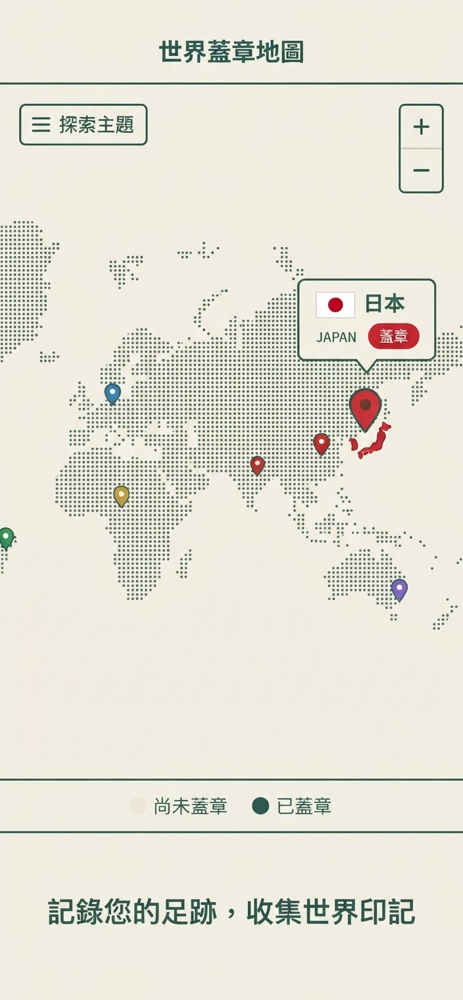
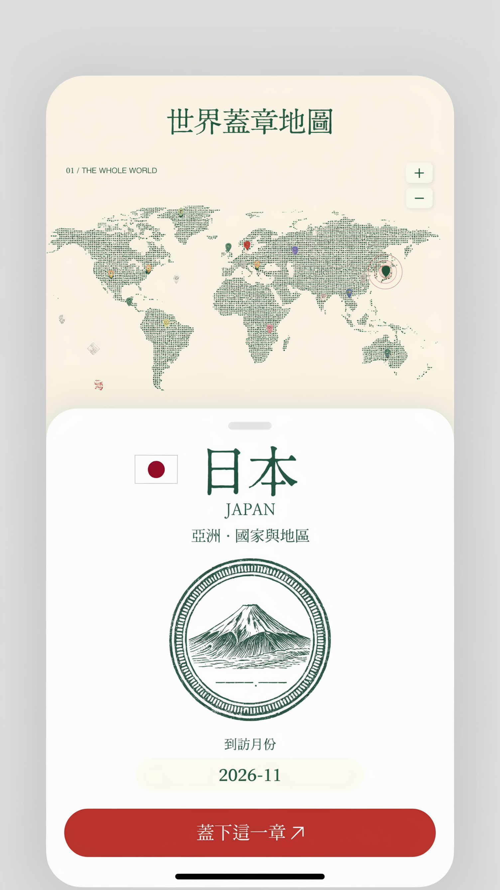
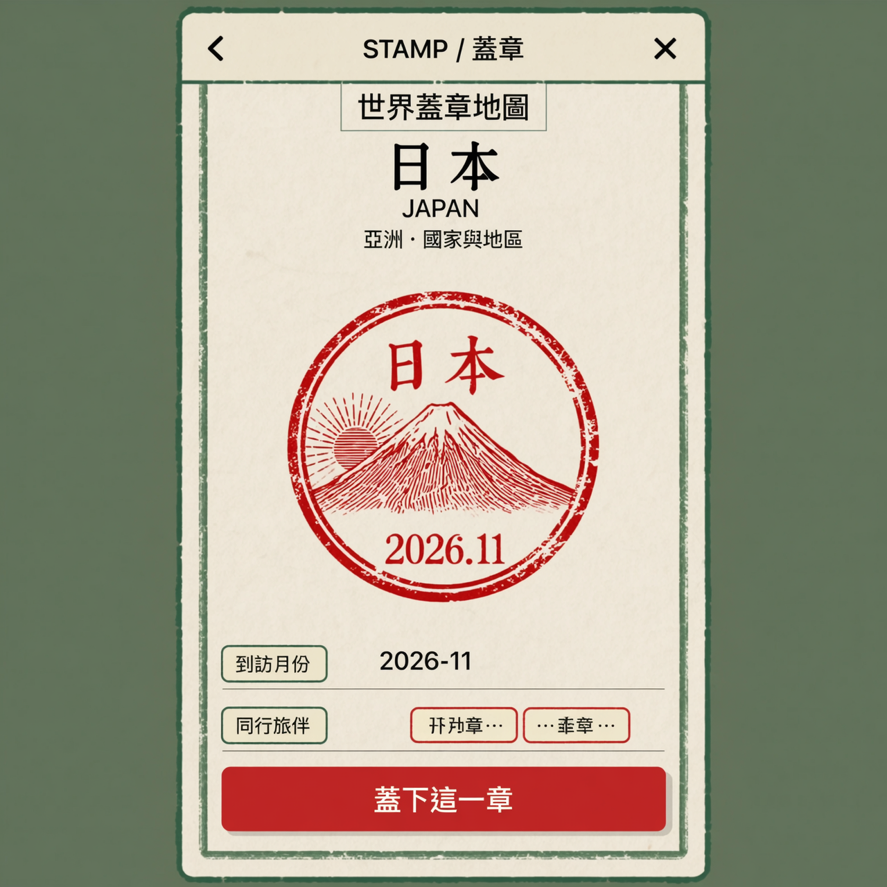

# 手機版蓋章地圖 UX 方案 proposals

> **已採用（2026-11）：** 「用卡片找地點、在地圖上上色」。地圖下方有搜尋、地區卡片與地點卡片輪播，滑動卡片時地圖會跟著標示；世界視角第一次點地圖只會打開該洲，第二次才打開明信片。明信片改為方案 B 的底部抽屜，並可用 ‹ › 在同一地區內連續蓋章（每次蓋章仍經過明信片）。詳見 README 的 “Mobile layout”。以下保留原始提案。

針對問題：**手機上一邊看地圖、點下去要能馬上看到地名，而且不用下滑就能蓋章**。

## 現況痛點（≤840px 單欄佈局）

- `style.css` 在 `@media(max-width:840px)` 把 `.atlas-grid` 改成單欄：地圖在上（465px，600px 以下 350px），`.stamp-panel`（地名、戳章預覽、月份、「蓋下這一章」鈕）在**地圖下方**，蓋章前一定要下滑。
- 地圖上的地名只靠 `pointermove` 的 tooltip（`app.js` `showTooltip`），手機上 tap 會觸發 `click → selectPlace()`，tooltip 反而被 `hideTooltip()` 關掉，所以點下去什麼都沒看到就跳去選取狀態。
- 從下方清單選地點時，`selectPlace(id, true, true)` 會把 `.stamp-panel` `scrollIntoView`，等於鼓勵下滑。

三個方案都把「看地圖 + 看地名 + 蓋章」收斂在**同一個地圖畫面內**，不需要頁面捲動。

---

## 方案 A｜地圖錨定標籤 Chip（最快：點 → 看名 →馬上蓋）

**互動流程**
1. 手指點到地圖上的 pin / 國家 →該標記上方直接浮出一個錨定 label chip：國旗 + 地名（日本）+ 英文（JAPAN）+ 小型紅色「蓋章」鈕。
2. 地圖完全不動、不捲動；再點一次 chip 的蓋章鈕就直接蓋章（月份預設當月，點 chip 上的日期可改月份）。
3. 點地圖其他地方或空白海面，chip 消失。

**優點**：兩次 tap 就完成蓋章，適合快速連續蓋很多地方；資訊密度最低、地圖最大。
**缺點**：chip 空間小，放不下戳章預覽、旅伴等；月份要預設值才行。
**適合情境**：瀏覽世界地圖、快速補蓋章。

---

## 方案 B｜底部抽屜 Bottom Sheet（資訊最完整，地圖仍然看得到）

**互動流程**
1. 點 pin / 國家 → 底部滑出約 55% 高的 sheet，蓋在地圖下半部：抓取把手、國旗 + 大標地名 + 英文 + 所在洲。
2. sheet 內就有戳章預覽、到訪月份、旅伴、「蓋下這一章」大按鈕——**看得到地圖，也不用捲頁面就能蓋章**。
3. 下拉或點 sheet 外的地圖區域收合；已選取的 pin 持續有選取光暈，地名也可一併顯示在 pin 上方。

**優點**：資訊完整（可放月份、旅伴、預覽），實作上最貼近現有 `.stamp-panel` 的內容，只是搬進 sheet；地圖始終可見可拖曳。
**缺點**：第一次點選要等 sheet 滑出動畫；頻繁蓋章時比方案 A 多一步收合。
**適合情境**：主要使用模式——看名字、確認資訊、正式蓋章。

---

## 方案 C｜全螢幕蓋章禮（儀式感最強）

**互動流程**
1. 點 pin / 國家 → 全螢幕接管（類似護照翻頁）：大標地名 + 大張戳章動畫壓下（油墨質感 + 日期），下方是月份、旅伴與「蓋下這一章」。
2. 蓋完按「返回地圖」，地圖上新的印記會閃一下回饋。

**優點**：蓋章的「爽感」最強，適合分享或重要地點；大螢幕放得下完整戳章圖稿。
**缺點**：一次只處理一個地點，連續蓋章時流程最長；會完全遮住地圖。
**適合情境**：第一次蓋某個重要地點、或想看完整戳章圖稿時。

---

## 推薦組合

**A + B 混合**：點下去先出方案 A 的錨定 chip（馬上看到地名＋快速蓋章鈕）；長按 pin 或點 chip 上的「詳細」則滑出方案 B 的 bottom sheet（完整資訊）。方案 C 保留給「蓋章動畫/預覽圖稿」場景，例如蓋完後的回饋，或從戳章圖稿索引進來時。

這樣「看地圖時點下去馬上顯示地名、不用下滑就能蓋章」三個需求一次滿足。

## 實作對照（現有程式碼）

| 需求 | 現況 | 改動位置 |
|---|---|---|
| 手機單欄時面板壓在地圖下 | `style.css` `@media(max-width:840px)` 的 `.atlas-grid{grid-template-columns:1fr}` | 新增 `.map-sheet` / `.map-chip` 元件的樣式（`position:absolute` 蓋在 `.map-surface` 內），≤840px 時隱藏原本的側欄式 `.stamp-panel` 或改為 sheet |
| tap 後 tooltip 被關掉 | `app.js` `selectPlace()` 內的 `hideTooltip()` | 手機寬度（`matchMedia('(max-width:840px)')`）改為顯示錨定 chip，桌機維持 hover tooltip |
| 蓋章鈕在畫面外 | `#stamp-button` 位於 `.stamp-panel-inner` | sheet 內重用同一個 `#stamp-button` 邏輯（`app.js` 986 行的 click handler 不變，只搬容器） |
| 清單選取會下滑 | `selectPlace(id,true,true)` 的 `scrollIntoView` | 手機版改為只置中地圖上的 pin（`focusPlace`），不捲動頁面 |
| 地圖高度 | ≤600px 時 `.map-surface{height:350px}` | 加上 chip/sheet 後維持不變，sheet 疊在地圖上、不佔版面 |

元件建議：chip 與 sheet 都放在 `.map-surface`（`position:relative`）內層，用 `transform: translateY()` 做滑入動畫，並尊重 `prefers-reduced-motion`。
